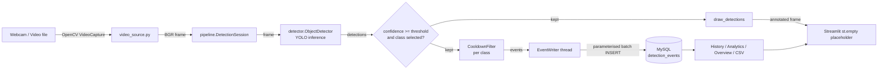

# Architecture

## Components and data flow

Text version: `capture → YOLO → filter → (draw | cooldown → queue → MySQL) → dashboard`.

### Per-frame sequence (`DetectionSession.step`)
1. `VideoSource.read()` returns the next frame (end of file → run ends and releases capture).
2. Every Nth frame (`process_every_n`), `ObjectDetector.detect()` runs YOLO with `conf`, `imgsz` and class ids.
3. Boxes are clamped to the frame and converted to `Detection` objects; **`filter_detections()` is applied again explicitly** (`confidence >= threshold` and class selected).
4. That one filtered list is (a) drawn with name + confidence %, (b) counted for the UI, (c) passed to the cooldown.
5. `CooldownFilter` lets a class through at most once per cooldown window; passing detections become event dicts and go to `EventWriter.submit()` (non-blocking).
6. The writer thread batches events into one `executemany` INSERT, commits, and updates counters (`inserted`, `failed`, `dropped`).

## Database schema (`detection_events`)

| Column | Type | Notes |
|---|---|---|
| `log_id` | BIGINT UNSIGNED, PK, AUTO_INCREMENT | required |
| `timestamp` | DATETIME(3) | required; app local time |
| `object_class` | VARCHAR(64) | required; YOLO class name |
| `confidence` | DECIMAL(5,4) | required; 0–1, CHECK constraint |
| `bbox_x`, `bbox_y` | INT | required; x1, y1 in original-frame pixels |
| `bbox_w`, `bbox_h` | INT UNSIGNED | required; x2−x1, y2−y1 |
| `source_type` | ENUM('webcam','video_file') | **added** |
| `session_id` | CHAR(36) NULL | **added**; UUID of the run |
| `created_at` | TIMESTAMP DEFAULT CURRENT_TIMESTAMP | **added**; server-side insert time |

Indexes: `idx_timestamp`, `idx_object_class`, `idx_session`.

## Threading model
* The Streamlit script thread does capture, inference and drawing (single thread → no shared mutable detection state).
* One daemon thread per run (`EventWriter`) writes to MySQL. Shared counters are protected by a lock; the queue is bounded (1000) so memory cannot grow without limit — when full, events are **dropped and counted**.
* `Stop`/end-of-video calls `EventWriter.stop()`, which flushes the queue and joins the thread.

## Why not other approaches?
* **`st.rerun()` loop:** reruns re-execute the whole script and are not a smooth video loop; a placeholder + `while` loop is simpler and reliable.
* **streamlit-webrtc:** browser-camera streaming is more complex (STUN/WebRTC); the assignment asks for OpenCV capture on a local laptop.
* **SQLite:** the assignment requires MySQL.
